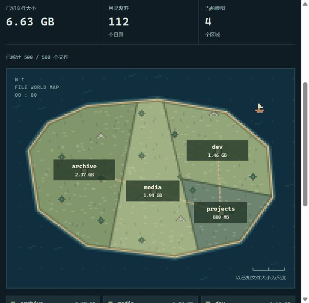
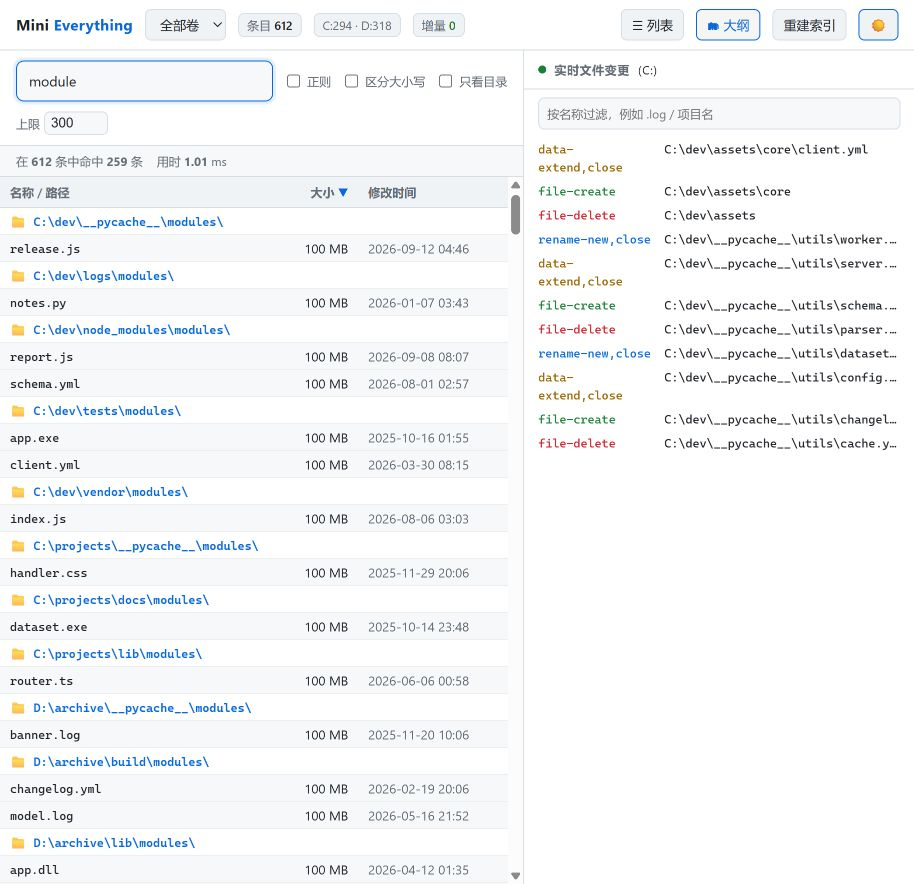

# mini-everything

**一个从零实现的「秒级全盘文件名搜索」工具** —— 思路与 [Everything](https://www.voidtools.com/) 一致：
不遍历目录，直接问 NTFS 要整张文件表（USN / MFT），再用 FRN 链重建完整路径。

A minimal, from-scratch take on the same idea as Everything: ask NTFS for the whole
MFT in one pass via `FSCTL_ENUM_USN_DATA`, rebuild paths from file references, and serve instant
searches — plus a live USN journal feed and a system-tray companion.



---

## 特性

- **秒级建索引**：`FSCTL_ENUM_USN_DATA` 一趟枚举整个 MFT，C 盘 36 万条约 4 秒、D 盘 151 万条约 15 秒
- **即时搜索**：187 万条里子串搜索 200–500 ms，支持正则 / 区分大小写 / 只看目录
- **大小与修改时间**：用 `FSCTL_GET_NTFS_FILE_RECORD` 直接解析 MFT 记录（`$DATA` / `$STANDARD_INFORMATION`），可点表头排序
- **实时变更**：读 USN 变更日志，创建 / 改名 / 删除**秒级并入可搜索索引**，右侧同时滚动展示事件流
- **多卷合并**：同时索引 C: 与 D:，合并搜索，可按卷过滤
- **本地 Web UI**：原生 HTML / CSS / JavaScript，无外部依赖；深色 / 浅色主题，世界地图 / 列表 / 大纲三种视图
- **像素文件世界**：默认按文件逻辑大小展示目录分布，可切换为文件数量；支持后台统计进度、逐层探索、面包屑导航、搜索筛选及按文件类型查看列表
- **系统托盘常驻小程序**：托盘图标 + 右键菜单 + 全局热键 + 开机自启（`tray.py`）
- **零第三方依赖跑核心**：USN/MFT 部分只用 Python 标准库 `ctypes` 调 Win32

## 截图

| 大纲视图 + 浅色主题 | 托盘图标 |
| --- | --- |
|  |  |

---

## 快速开始

需要 **Windows + Python 3.8+**。读取 NTFS 卷需要**管理员权限**（否则自动降级为递归遍历）。

### 1) 命令行

```bash
python mini_everything.py index C -o index_C.txt   # 建索引（USN/MFT）
python mini_everything.py find report              # 子串搜索
python mini_everything.py find "\.dll$" -r         # 正则搜索
python mini_everything.py find todo -n 20          # 限制条数

python mini_everything.py watch C -s 30            # 监听 30 秒的文件变更
python mini_everything.py watch C --all            # 连数据写入一起显示
python mini_everything.py watch C -g myfile        # 只看名字含 myfile 的
```

### 2) 网页界面

```bash
python webapp.py --port 8787 --volumes CD    # 然后打开 http://127.0.0.1:8787/
python webapp.py --demo                      # 合成样本，无需管理员/真实磁盘
```

世界地图的「按文件大小」模式会在后台读取当前范围内**全部匹配文件**的元数据，
将目录后代文件的逻辑字节数汇总到地区，不受搜索列表 3000 条采样限制。
统计期间显示已处理数量；待统计、无法读取大小及已知的零字节文件分别处理，
标签中的 `+` 表示还有大小未知的文件。大小与类型图例同步切换。

大小结果是一次扫描的快照。文件发生变化后会提示「重新统计」；
切换为「按文件数量」无需等待大小扫描。
只看目录时会隐藏直接文件的类型地区，仍累计目录内部文件的大小。
逻辑大小不等于实际磁盘占用：压缩、稀疏文件及索引未覆盖的空间不在此指标内。
所有已知大小的地区拼成一块相连大陆，共用内部边界，使用道路连接各地区中心。
地区面积与已知文件字节数成正比，4 倍大小对应 4 倍面积；小文件不设置最小面积。
零字节与未知大小不分配陆地，仍可从地区清单点击探索。地图按可用空间决定是否显示地区内的标签。
像素边界的取整会有微小误差，精确值以标签为准。

### 3) 系统托盘常驻小程序

托盘额外依赖 `pystray` 与 `Pillow`，先安装（命令行和网页界面无需第三方依赖）：

```bash
python -m pip install -r requirements-tray.txt
```

```bash
pythonw tray.py --port 8787 --volumes CD     # 无控制台窗口（推荐）
pythonw tray.py --open                       # 启动并直接打开搜索窗口
```

右键托盘图标：

| 菜单项 | 作用 |
| --- | --- |
| 打开搜索窗口（双击图标同效） | 用默认浏览器打开 UI |
| 重建索引 C: / D: | 对该卷重跑 USN/MFT 枚举 |
| 暂停 / 恢复实时监听 | 停/启 USN 读取线程，恢复后从上次 USN 续读、不丢事件 |
| 开机自启 | 写 `HKCU\...\CurrentVersion\Run`，命令用 `pythonw.exe` |
| 全局热键 `Ctrl+Alt+E` | 任何地方按下即弹出搜索窗口 |
| 状态行 | `187 万项 · 增量 N · 监听中` |
| 退出 | 结束进程并关闭它启动的服务 |

托盘启动时会先探测端口：已有服务就**附着**（不重复建索引），否则自己建索引并起服务。

---

## 工作原理

### 用到的关键控制码

读取卷和 MFT 需要下面这几个 NTFS 控制码，都通过 `DeviceIoControl` 调用：

| 控制码 | 名称 | 用途 |
| --- | --- | --- |
| `0x000900B3` | `FSCTL_ENUM_USN_DATA` | 枚举整个 MFT，建立全量索引 |
| `0x000900F4` | `FSCTL_QUERY_USN_JOURNAL` | 取日志 ID 与 NextUsn |
| `0x000900BB` | `FSCTL_READ_USN_JOURNAL` | 增量读取创建/改名/删除 |
| `0x00090064` | `FSCTL_GET_NTFS_VOLUME_DATA` | 卷几何（用于取每记录字节数） |
| `0x00090068` | `FSCTL_GET_NTFS_FILE_RECORD` | 按 FRN 读一条 MFT 记录 |

### 建索引（不遍历目录）

1. 打开裸卷句柄 `\\.\X:`
2. `FSCTL_ENUM_USN_DATA` 返回一串 `USN_RECORD`，每条带 `FileReferenceNumber`(FRN) 与
   `ParentFileReferenceNumber`；回复的前 8 字节是下次的起始 FRN，循环到 `ERROR_HANDLE_EOF`(WinError 38) 为止
3. 用父子 FRN 链回溯到卷根（FRN 5）重建完整路径；同一个 FRN 的 8.3 短名会被长名替换

### 从 MFT 取大小与时间（踩过的三个坑）

`FSCTL_GET_NTFS_FILE_RECORD` 拿到的记录需要自己解析属性：

| 现象 | 正确处理 |
| --- | --- |
| `$FILE_NAME` 的时间戳只在改名时刷新，常年过期 | 时间取 **`$STANDARD_INFORMATION`(0x10)** 的 offset 8 |
| 压缩/稀疏属性的 `RealSize` 高 16 位是压缩单元 | 大小 = `RealSize & 0xFFFFFFFFFFFF` |
| 记录里只有 `$ATTRIBUTE_LIST`(0x20)，`$DATA` 在扩展记录中 | 返回"未知"交给文件系统兜底，**不采信占位假值** |

抽样 **28,069 个文件，99.99% 与 `os.stat` 一致**，单次约 20–45 µs。
（`$DATA` 的 `RealSize` 只在 off+48；对照组里未屏蔽压缩位的原始值正确率仅 ~15%。）

### 实时增量

后台线程 `FSCTL_READ_USN_JOURNAL` 持续读取，事件同时：
- 推给网页的 SSE 面板
- 按 `(FRN, 父FRN)` 维护目录映射，**直接写进内存索引**（增量按路径去重，避免一次创建产生 3 条记录）

监听线程带"代次"（generation）控制，暂停 / 恢复不会同时存在两个读取线程。

---

## 性能实测（Windows 11，管理员）

| 卷 | 条目数 | 建索引耗时 |
| --- | --- | --- |
| C: | 361,344 | 4.2 s |
| D: | 1,513,740 | 15.5 s |
| 合计 | **1,875,084** | 并行 |

| 查询 | 命中 | 耗时 |
| --- | --- | --- |
| 子串 `notepad` | 439 | ~0.2 s |
| 子串 `log` | 85,270 | ~0.25 s |
| 正则 `\.dll$`（单卷） | 5,691 | ~2 s |
| 按大小排序 | 85,270 | 首次 ~3 s（需统计采样），之后 ~0.24 s |

对比：同样内容递归遍历目录需要 24.6 s、43 万条（USN 路径约快 10 倍）。

---

## 项目结构

```
mini_everything.py   # 引擎：USN 枚举、路径重建、MFT 属性解析、实时日志
webapp.py            # 本地 HTTP 服务：搜索、世界地图聚合、统计、SSE、监听与重建
index.html           # 搜索、排序、主题、视图、实时面板
islands.js           # 世界地图导航、像素村庄、真实文件村民与详情名册
world-layout.js      # 相连大陆分区、面积等比例布局与道路连接
islands.css          # 像素风样式与响应式布局
tray.py              # 系统托盘常驻小程序
demo.py              # 合成样本数据（供 --demo 与截图使用）
docs/                # 截图
```

## 已知局限

- 只索引**名称 + 大小 + 修改时间**，没有内容搜索、没有属性(只读/隐藏)过滤
- 每个文件只保留一个名字：硬链接 / 多个 `$FILE_NAME` 记录会合并
- 实时增量走"覆盖层"：目录改名会把旧子树标记隐藏、新路径走实时 FRN 映射；点「重建索引」可完全同步
- 搜索列表按大小/时间排序只统计**有界采样**（默认 3000 条），界面上会明确提示；世界地图大小模式后台统计全部匹配文件
- 快速路径需要管理员权限；非管理员运行时会自动降级为递归遍历
- 网页 / 托盘的递归降级模式保留目录类型，但不提供实时日志更新；文件清单需手动重建
- 常驻约 1.2 GB 内存（两卷路径 + 小写副本 + 目录 FRN 映射）
- 仅支持 NTFS / ReFS；FAT/exFAT 没有 USN 日志，会走遍历降级路径

## 验证

```bash
python -m unittest -v
node --test test_world_layout.js
```

回归检查使用合成索引和模拟卷接口，不需要管理员权限，也不会扫描真实磁盘。
目录查询通过有序路径索引和二分查找定位子树，搜索、数量概览和大小统计只处理当前子树；全盘概览仍需处理全盘文件。实时新增和删除记录会合并到查询结果中，重建索引时替换索引，已有统计继续使用稳定快照。地图与村民名册并行加载，地图显示不等待名册。
目录在地图中绘制为沿道路相连的像素村庄，点击进入后，直接包含的文件以像素村民展示。
实时文件变更面板默认收起，点击顶部「展开实时变更」可查看，收起后地图自动占满可用宽度。后台日志监听仍默认关闭，可在面板内点击「开启实时变更」手动启用，也可随时关闭。展开或收起面板不会切换监听状态，关闭监听期间可通过「重建索引」更新文件清单。
村民颜色区分文件类型，点击可查看真实文件名、完整路径、大小和修改时间。
名册按路径最多展示前 48 个文件，并标明总数；地图只摆放有足够空间的村民，零字节或未知大小的文件仍可通过名册查看。
地区面积继续按文件大小分配，房屋和村民仅作为图标，不改变面积比例。可用 `/?scope=D%3A%5Cfolder` 直接打开某个目录。
覆盖多卷名称排序、增量去重、属性缓存失效、递归降级、日志回放起点与网页 API。
世界地图检查还覆盖完整数量统计、目录边界、类型分组、空目录、增量缓存失效与静态资源接口。
大小模式覆盖字节汇总与排序、零字节和未知大小区分、超过采样上限、后台扫描、快照失效提示及重新统计。

## 许可

MIT。仅供合法的软件研究与学习用途；请只分析你拥有或获授权的软件。
